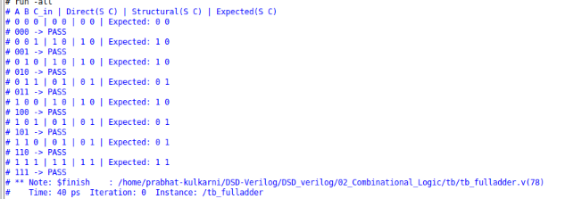
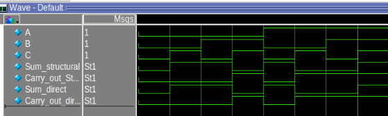

# Combinational Logic — Verilog RTL

This directory contains basic combinational circuits implemented in **Verilog HDL**. It compares two ways of describing a Full Adder: direct dataflow logic and a structural design built from Half Adders.

## Circuits

### 1. Half Adder

Adds two 1-bit inputs and produces a Sum and Carry output.

- RTL: [`src/half_adder.v`](./src/half_adder.v)
- Schematic: [Half Adder schematic (PDF)](./schematic%20diagram/half_adder.pdf)

### 2. Full Adder — Dataflow Implementation

Uses Boolean expressions to describe the Full Adder outputs.

Inputs: `a`, `b`, `c_in`  
Outputs: `sum`, `c_out`

```text
sum   = a XOR b XOR c_in
c_out = (a AND b) OR (c_in AND (a XOR b))
```

- RTL: [`src/full_adder_direct.v`](./src/full_adder_direct.v)
- Schematic: [Dataflow Full Adder schematic (PDF)](./schematic%20diagram/full_adder_direct.pdf)

### 3. Full Adder — Structural Implementation

Instantiates two Half Adders and combines their carry outputs with an OR operation.

- RTL: [`src/full_adder_structural.v`](./src/full_adder_structural.v)
- Dependency: [`src/half_adder.v`](./src/half_adder.v)
- Schematic: [Structural Full Adder schematic (PDF)](./schematic%20diagram/full_adder_structural.pdf)

## Verification

The testbench instantiates both Full Adder implementations and applies all **eight input combinations** of `a`, `b`, and `c_in`.

For each test case, it compares the outputs of both designs with the expected Sum and Carry values and prints `PASS` or `FAIL`.

- Testbench: [`tb/tb_fulladder.v`](./tb/tb_fulladder.v)
- Simulator: ModelSim Intel FPGA Edition

### Simulation Evidence

**Self-checking testbench transcript**



**Waveform**



## RTL Modelling Comparison

| Implementation | How it is described | Main concept |
|---|---|---|
| `full_adder_direct.v` | Boolean/dataflow expressions | Describe logic using equations |
| `full_adder_structural.v` | Half Adder module instances and an OR operation | Build a circuit by connecting smaller modules |

Both Full Adder implementations are checked against the same expected outputs. This verifies their functional behaviour for every possible 1-bit input combination.

## Project Files

- `src/` — synthesizable Verilog modules
- `tb/` — Full Adder testbench
- `simulation/` — waveform and transcript screenshots
- `schematic diagram/` — PDF schematics
- `02_Combinational_Logic.qpf` and `02_Combinational_Logic.qsf` — Quartus project files

The repository includes a Quartus project configuration; this README documents **RTL simulation evidence**, not physical FPGA-board testing.

## Tools

- Verilog HDL
- ModelSim Intel FPGA Edition
- Intel Quartus Prime Lite
- Linux
